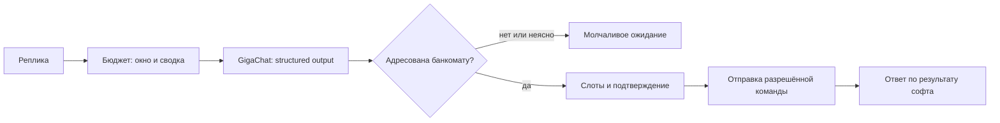

# Агент банкомата

Учебный проект по заданию 2. GigaChat извлекает параметры реплики, LangGraph хранит состояние диалога, приложение отправляет команды софту банкомата.


## Структура

```text
atm_agent/
├── cli/              # терминальный интерфейс
├── config/           # настройки, диагностика, общие пути
├── dialogue/         # состояние операции и граф LangGraph
├── understanding/    # извлечение намерений и параметров, адресованность
├── atm/              # контракт софта банкомата и заглушка
├── context/          # бюджет токенов и свёртка истории
├── knowledge/        # PDF, редакции, фрагменты, сборка индекса
├── retrieval/        # поиск, реранкер, эмбеддинги и консультации
├── memory/           # профиль, Store, удаление и отдельный worker
├── scenarios/        # демонстрационные и живые проверки
├── prompts/          # инструкции для моделей
├── tests/            # автоматические тесты
├── data/             # извлечённые документы, индексы, базы и отчёты
├── __main__.py       # вход python -m atm_agent
├── run.sh
├── .env.example
├── requirements.txt
└── requirements.lock.txt
```

Это Python-пакет; внутренние импорты начинаются с `atm_agent`. `config/paths.py` определяет корень приложения и пути к данным и промптам. Настоящий `.env`, виртуальное окружение и данные остаются в корне `atm_agent` и соответствующих каталогах данных.

`run.sh` можно вызвать из любой папки. Как и раньше, относительные пути в его аргументах отсчитываются от `atm_agent`. Для прямого запуска Python-модулей текущая папка должна быть родительской по отношению к `atm_agent`:

```sh
atm_agent/.venv/bin/python -m atm_agent --trace
atm_agent/.venv/bin/python -m atm_agent.memory.worker --help
atm_agent/.venv/bin/python -m atm_agent.knowledge.build_index --help
```

Старые команды вида `python atm_agent/chat.py` заменены модульным запуском. Обычные команды `./atm_agent/run.sh --trace`, `--test`, `--setup-rag` и флаги сценариев сохранены; `--demo` запускает локальный пример без API.

## Запуск

Нужны Python 3.10+, сеть, PDF в корневой папке `docs` и заполненный `atm_agent/.env` по образцу `.env.example`: ключ GigaChat для диалога и ключ Cloud.ru для эмбеддингов. Ключи в репозиторий не добавляются.

Из корня репозитория полный запуск выполняется одной командой:

```sh
./atm_agent/run.sh --trace
```

Скрипт создаёт `.venv`, устанавливает зависимости, проверяет PDF и редакции, подготавливает недостающий текст, загружает локальный реранкер и строит отсутствующий или несовместимый индекс, затем открывает диалог. Первый запуск требует скачивания весов и оплаченных запросов эмбеддингов. Готовый совместимый индекс используется повторно; кэш позволяет продолжить прерванную сборку без повторной оплаты уже сохранённых векторов. Ошибка подготовки останавливает запуск, а не отключает RAG.

Проверка подключения отдельно, без подготовки RAG, из папки `atm_agent`:

```sh
./run.sh --check
```

Скрипт создаёт `.venv` и устанавливает зависимости. Для установки нужны PyPI и сеть; для диалога — доступ к GigaChat. Версии прямых зависимостей указаны в `requirements.txt`, установленное окружение — в `requirements.lock.txt`.

Настройки читаются из окружения или первого найденного `.env`: в папке проекта, в родительской папке, затем в соседнем `prompting_and_tokenization_sber_2026`. Существующие переменные окружения имеют приоритет. Ключи не копируются и не печатаются. Можно указать другой файл:

```sh
./run.sh --env-file /путь/к/.env --trace
```

Названия переменных — в `.env.example`. Значение проверки сертификатов берётся из настроек; по умолчанию проверка включена.

## Что реализовано

- Structured output через `with_structured_output(ParsedTurn, include_raw=True)`. Извлекаются адресованность, действие, сумма, номинал или точный состав купюр.
- Накопление параметров между репликами, отдельный вопрос о подтверждении выдачи. Исправление суммы или купюр требует нового подтверждения. Если модель вместе с `confirm` повторила прежние значения из контекста, они сравниваются с текущим предложением: совпадение не считается правкой.
- Посторонние и неоднозначные реплики не вызывают ответа или команды, не меняют параметры и не попадают в содержательную историю.
- Пауза («я ещё думаю», «вернёмся позже») сохраняет параметры и отключает принятие подтверждения. Явная отмена очищает операцию.
- Вопрос о продукте или балансе приостанавливает подтверждение снятия. После него агент повторяет вопрос о выдаче, прежде чем принимать согласие.
- `get_balance`, `withdraw` и `start_deposit` отправляются софту банкомата. Сумма внесения приходит от купюроприёмника. Ответы различают ожидание, успех и отказ.
- Checkpointer разделяет сессии по `thread_id`. Пока используется `InMemorySaver`: состояние текущего диалога живёт до завершения процесса. Предпочтение и эпизоды отдельно сохраняются в LangGraph Store на SQLite и переживают перезапуск.
- В диагностике отображаются извлечённые поля, слоты, команды, результаты и фактический `usage_metadata`. Токены не оцениваются по длине текста.

## Как устроен один ход



`understanding/extractor.py` и `prompts/extractor_prompt.txt` отвечают за понимание текста. `dialogue/state.py` содержит переходы состояния без сетевых вызовов. `dialogue/graph.py` связывает извлечение, переходы, выполнение и историю; предложение на выдачу хранится в состоянии графа, а не в отдельном объекте сессии. `atm/contracts.py` задаёт интерфейс софта и проверяет аргументы команд.

Успех операции сообщается по ответу софта. При ошибке транспорта результат считается неизвестным: новые команды блокируются до выяснения статуса. Реальный протокол получения статуса подключим при интеграции; автоматического повтора выдачи нет.

## Проверка

Вымышленные разговорные примеры для демонстрации памяти внутри диалога и между сессиями — в [examples/memory](examples/memory/README.md). Набор содержит ожидаемое поведение; результат живого прогона фиксируется отдельно.

```sh
./run.sh --test -v
./run.sh --demo
./run.sh --scenario --trace
```

`scenarios/demo.py` показывает локальные переходы на заранее заданных результатах извлечения, без модели и графа. `--scenario` выполняет тот же короткий проход на настоящем GigaChat и LangGraph: снятие → сумма → объявление → купюры → подтверждение. Скрипт проверяет единственную команду с суммой 7000 и номиналом 1000 после согласия.

Тесты проверяют накопление слотов, прерывания, правки, отказ, подтверждение, связь ответа с командой и внесение. При отсутствии библиотек тесты схемы и графа явно пропускаются. Тесты графа используют заданные ответы извлекателя: они проверяют checkpointer и маршруты, а не качество модели.

После установки зависимостей все локальные тесты, включая LangGraph, проходят. Живой сценарий проверен 26 октября 2026 на GigaChat-3-Ultra: объявление проигнорировано, сумма и купюры сохранены, одна команда на выдачу 7000 ₽ тысячными отправлена после подтверждения. Для сетевого запуска из Codex CLI потребовалось разрешение на выполнение вне песочницы. При `--check` выводятся модель, scope, HTTP-статус, этап запроса и числовой код ошибки API; ключи, тела ошибок и заголовки не печатаются.

## Пример диалога

```text
Вы: Хочу снять
Агент: Какую сумму хотите снять?
Вы: Семь тысяч
Агент: Какими купюрами выдать? Можно на выбор банкомата.
Вы: Объявляется посадка на рейс
Вы: Тысячными
Агент: Выдать 7000 ₽, купюрами по 1000 ₽?
Вы: Да
Агент: Банкомат сообщил о выдаче 7000 ₽.
```

Софт в терминальном примере — симулятор одного счёта с начальным балансом 50000 ₽. Успешная выдача уменьшает остаток; при нехватке средств возвращается отказ. Внесение увеличивает баланс только после события купюроприёмника. Повтор той же команды или события не изменяет баланс второй раз. `/new` сохраняет остаток, поскольку софт продолжает работать в том же процессе; после перезапуска программы баланс снова 50000 ₽. Реальных банковских операций нет. Для внесения:

```text
Вы: Хочу внести десять тысяч
Агент: Внесите купюры в купюроприёмник.
Вы: /accepted 12500
Агент: Зачислено 12500 ₽ по данным банкомата.
```

`/accepted` — событие учебного устройства, оно обходит языковую модель. `/new` создаёт новую сессию, `/exit` завершает программу.


## Бюджет контекста: критерий 2

`prepare_context` — отдельный узел LangGraph перед извлечением реплики. Он сохраняет последние полные ходы пользователя/агента, сводку старой переписки и отдельный список ссылок. История больше не обрезается молча до 12 сообщений.

| Настройка | По умолчанию | Назначение |
|---|---|---|
| `CONTEXT_INPUT_TOKENS` | 4096 | Вход одного вызова извлечения или суммаризации |
| `RAG_INPUT_TOKENS` | 12000 | Вход одного вызова выбора поиска или ответа по документам |
| `CONTEXT_SUMMARY_TOKENS` | 384 | Максимальный выход суммаризатора |
| `CONTEXT_RECENT_TURNS` | 4 | Сколько свежих полных ходов оставлять после свёртки |
| `MODEL_MAX_OUTPUT_TOKENS` | 1024 | Максимальный выход извлечения и выбора инструмента |
| `RAG_MAX_OUTPUT_TOKENS` | 2048 | Максимальный выход ответа по документам, включая structured output и цитаты |

Это бюджеты входа одного запроса, а не стоимость всего хода. Плановый лимит суммы входа и выхода при стандартных настройках — 5120 для диалогового вызова, 14048 для ответа RAG; суммаризатор ограничен меньшим выходом. Один пользовательский ход может включать несколько запросов и суммарно потратить больше токенов.

Перед вызовом `tokens_count` GigaChat считает сериализованные сообщения и схемы инструментов. Дополнительно резервируются 256 токенов на различия формата чата. В журнале это `preflight`, а не фактическое потребление. После ответа сохраняется настоящий `usage_metadata`, отдельно для каждого этапа. Если tokenizer недоступен, приложение не подменяет его оценкой по символам и не отправляет неконтролируемый запрос.

Суммаризация запускается, если подготовленный вход не помещается в бюджет или накопилось больше двух окон свежих ходов. Выпадающий префикс сворачивается, последние полные ходы сохраняются. При необходимости окно уменьшается до последнего полного хода; сводка и обязательные поля состояния тоже входят в проверку. Большой префикс обрабатывается несколькими ограниченными порциями. Файл `prompts/summary_prompt.txt` настроен на банкомат: незавершённая тема, поправки, даты продуктов, явные намерения и различие между прошлой и текущей операцией.

Сумма, купюры, команда и флаг подтверждения остаются в структурированном состоянии. Сводка их не меняет, не отправляет команды и не создаёт предпочтения в Store. Входной JSON помечен как данные. Нормализованные ссылки на последние 12 разных страниц извлекает Python из уже показанных цитат и сохраняет в `summary_citations`; модель не генерирует этот список. Сводка и ссылки передаются RAG только для понимания вопроса, но не становятся доказательствами банковских условий.

У числовых параметров извлечения есть дословные `*_quote` из текущей реплики. При переносе числа из старого контекста без подходящей опоры поле отбрасывается; пустое значение не заменяется нулём. Это защита от копирования истории, не доказательство правильности интерпретации числительного. Подтверждение выдачи остаётся отдельным шагом.

При ошибке сводки старые история и сводка не заменяются частичным результатом. Если обязательный контекст с текущей репликой не помещается, запрос отклоняется без отправки команды. Уже полученный usage суммаризатора учитывается и при неудачной свёртке. Если фактический вход превысил бюджет несмотря на preflight, результат извлечения не допускается к выполнению операции; перерасход остаётся виден в журнале.

RAG проверяет и планирование инструмента, и генерацию, и попытку исправить цитаты. Найденные фрагменты при этом не пересказываются суммаризатором: опорная цитата должна оставаться дословной. Если доказательства не помещаются, консультация завершается ошибкой; стоимость уже выполненного выбора инструмента сохраняется.

В `--trace` доступны:

- `usage` — извлечение и, при необходимости, отдельная обработка предпочтения;
- `turn_usage` — сумма фактических токенов всех ответов моделей за ход, включая сводку и RAG;
- `session_usage` — накопленный расход сессии, включая проигнорированные посторонние реплики;
- `budget` / `budget_log` — preflight, входной лимит и фактический usage каждого вызова;
- `summary`, `summary_citations`, `summary_revision` и число свёрнутых сообщений.

Подсчёт tokenizer используется для планирования, а не подменяет usage ответа. Токены, которые посчитал `tokens_count`, не складываются с расходом генераций. При ошибке без ответа модели расход неизвестен; приложение не выдумывает его. Сводка и окно изолированы по `thread_id`. Запрос полного удаления очищает их вместе со всеми checkpoints клиента и кэшем счётчика.

### Длинный сценарий

```sh
./atm_agent/run.sh --context-scenario
```

Сценарий выполняет 35 реплик на живом GigaChat, использует реальный RAG и временный Store. В начале клиент сообщает 7000 ₽, затем задаёт вопросы о продуктах и балансе, формулирует предпочтение, возвращается к снятию через десятки реплик и выбирает тысячные. Пять фоновых реплик игнорируются, включая обращение «да» к соседу перед выдачей. Проверяется ровно одна команда на 7000 ₽ тысячными после последнего подтверждения.

Две консультации проверяют разные редакции СберПрайм, ещё одна — явный `source_id=sberprime-offer@2026-03-01`. Перед каждым ходом отдельно измеряется контрфактический вход со всей накопленной историей без сводки: это сравнение размеров, а не измеренная стоимость второго запуска модели. Отчёт — `data/context/long_dialogue_report.json`: фактические расходы по вызовам, версии сводки, сохранённые ссылки, результаты поиска и команды. База интерактивного клиента не изменяется; данные сценария вымышленные.

Проверено 29.10.2026 на GigaChat-3-Ultra: 35 реплик прошли, пять фоновых обращений проигнорированы, 50 сообщений свёрнуты в пять последовательных сводок. Максимальный фактический вход отдельного диалогового вызова — 2798 токенов при бюджете 4096; RAG — 6177 при бюджете 12000. Без свёртки сериализованный вход к концу сценария достиг 4537 токенов ещё до защитного резерва. По всем 48 вызовам получен usage, превышений бюджета нет. Общий фактический расход — 112 450 входных и 8421 выходной токен (120 871 всего); сюда включены сводки, извлечение, выбор инструментов, генерация и исправления ответов. Это данные контрольного запуска, не обещание одинаковой стоимости повторов.

Сумма, названная на третьей реплике, сохранилась до 35-й: отправлена ровно одна команда выдачи 7000 ₽ тысячными после подтверждения. Ссылки обеих редакций сохранились в `summary_citations`, а вопрос с точным идентификатором вызвал поиск с соответствующим `source_id`. Полный локальный набор: 122 теста; Ruff `--select F` проходит. Среди проверок — сбой tokenizer, сохранение истории при неудачной сводке, фактический перерасход, неполный RAG-вызов, изоляция сессий и удаление сводки вместе с памятью.


## Память клиента

В терминальном режиме считыватель карты имитируется аргументом `--client-id` (по умолчанию `demo_albina`). Идентификатор передаётся приложением через конфигурацию графа, не извлекается из слов клиента. Для другого клиента нужен новый `thread_id`; смена идентификатора в существующей сессии отклоняется.

```sh
./atm_agent/run.sh --client-id demo_albina --trace
./atm_agent/run.sh --client-id demo_boris --trace
```

`/new` начинает новую сессию того же клиента. После выхода и повторного запуска с тем же идентификатором память также доступна. Незавершённое снятие, согласие на выдачу и история диалога в долговременную память не переносятся.

`memory.store.SqliteStore` реализует интерфейс LangGraph `BaseStore`, подключён через `compile(store=...)`. Узлы чтения и записи обращаются к этому Store. Поддержаны get/put/delete, точные фильтры, поиск `query` по эмбеддингам и асинхронные варианты через `abatch`. Подготовка векторов выполняется отдельным процессом, а не узлом диалога.

По умолчанию база находится в `atm_agent/data/memory/store.sqlite3`, исключена из Git. Для отдельной учебной базы можно передать `--memory-db /путь/store.sqlite3`. Новых библиотек для хранения не требуется.

Хранилища разделены:

| Роль | Где хранится | Срок использования |
|---|---|---|
| Слоты, незавершённая операция, история | Checkpointer, отдельный `thread_id` | До завершения процесса |
| Явное предпочтение купюр | Store: `clients/<client_id>/profile` | 180 дней |
| Успешная выдача | Store: `clients/<client_id>/episodes` | 30 дней |
| Документы продуктов и редакции | Отдельный RAG-индекс | По интервалам действия редакций |
| Трассировки продуктовых консультаций клиента | Файлы RAG + реестр владельцев | 30 дней или удаление по просьбе |
| Минимальные квитанции и аудит | Служебные таблицы Store | 365 дней с даты события |

Сроки 180/30 дней — настройки учебного проекта, не нормативные сроки хранения банка. Меняются через `MEMORY_PREFERENCE_DAYS` и `MEMORY_EPISODE_DAYS`. Запись содержит `schema_version`, `kind`, `source`, `denomination`, `atm_choice`, `amount`, `notes`, `request_id`, `created_at`, `expires_at`; лишние поля и некорректные сочетания отклоняются. Сумма и состав купюр относятся только к эпизодам, предпочтение суммы не хранит.

Правила записи и чтения:

- «Запомни: обычно выдавай тысячными» создаёт явное предпочтение. Обычная просьба «выдай тысячными» меняет только текущую операцию. Агент подсказывает формулировку при первом выборе купюр или после успешной выдачи, один раз за сессию.
- Общий извлекатель распознаёт намерение `preference`; затем отдельный structured output `ParsedPreference` извлекает действие и номинал только из текущей просьбы, без истории операций. Этот дополнительный вызов выполняется только для адресованных просьб о памяти. Фактические токены обоих вызовов складываются в `usage`.
- Новое явное предпочтение заменяет предыдущее; разовая выдача другим номиналом его не меняет. Предпочтение важнее любого более свежего эпизода.
- Эпизод создаётся только после `completed` от устройства, при совпадении идентификатора и суммы с командой. Повторная запись того же `request_id` не продлевает срок действия.
- При отсутствии действующего предпочтения предлагается выбор из последней действующей успешной выдачи. Прошлая сумма не заполняет слот суммы. Точный состав купюр прошлого снятия не переносится на новую сумму.
- Память лишь предлагает купюры. Первое «да» выбирает их, затем задаётся отдельный вопрос «Выдать …?». Только второе согласие отправляет команду. Клиент может сразу назвать другой номинал.
- Несовместимый с суммой номинал не предлагается; истёкшая между предложением и ответом запись не используется. Посторонняя речь не читает и не изменяет профиль или эпизоды.
- «Забудь предпочтение по купюрам» удаляет только предпочтение. «Удали всю память обо мне» удаляет профиль, эпизоды и производные данные; служебные исключения описаны ниже.

Срок действия проверяется при чтении, без автоматического продления. Физическую очистку записей, векторов и заданий выполняет отдельный обработчик; до его запуска просроченные записи уже исключены из использования. Ошибка записи эпизода отображается в `memory_error` и не превращает подтверждённую устройством выдачу в неизвестный результат.

Живой сценарий с отдельной временной базой:

```sh
./atm_agent/run.sh --memory-scenario
```

Он проверяет успешную выдачу, закрытие и повторное открытие Store, предложение прошлых купюр, два отдельных согласия, приоритет явного предпочтения, разовую смену номинала и изоляцию другого клиента. Не использует базу клиента из интерактивного режима. Отчёт — `atm_agent/data/memory/scenario_report.json`.

Проверено 29.10.2026 на GigaChat-3-Ultra: живой сценарий прошёл, отправлены ровно три команды после подтверждений; предпочтение 500 ₽ сохранилось после разовой выдачи тысячными. Отдельный локальный тест читает предпочтение в новом Python-процессе. Проверки включают срок действия во время ожидания согласия, изоляцию клиентов, ошибки памяти и поля, повторённые моделью из контекста; управление жизненным циклом проверяется дополнительными тестами ниже.


## Управление памятью: критерий 6

Аудит фиксирует создание, обновление, чтение, смысловой поиск, удаление, индексацию и ошибки индексации. Изменение записи, событие аудита и задание для worker сохраняются атомарно: при ошибке транзакция откатывается. Аудит содержит тип операции, роль, время, причину и HMAC-идентификаторы клиента/записи. Значения предпочтений, суммы, исходные фразы и тела ошибок в него не копируются. HMAC — псевдонимизация, не анонимизация; ключ хранится в самой базе.

Учебная политика обязывает сохранять служебный минимум 365 дней (`MEMORY_SERVICE_RETENTION_DAYS`). Это выбранное правило проекта, не нормативный срок хранения банка. Квитанция содержит только `request_id`, действие, статус, время завершения и окончание хранения. Сумма, купюры и предпочтение в неё не входят. Эпизод и квитанция записываются одной транзакцией; повтор того же результата не продлевает срок и после удаления не создаёт эпизод заново. Существующие эпизоды при миграции получают минимальные квитанции; исторический аудит задним числом не выдумывается.

Полный запрос удаления очищает:

- профиль, эпизоды, поисковые векторы и очередь обработки;
- все checkpoints этого клиента в текущем экземпляре приложения, включая прежние сессии;
- принадлежащие клиенту локальные трассировки RAG. У других клиентов записи сохраняются.

Служебные квитанции и аудит остаются до своего `retain_until`, затем их удаляет worker. Срок начинается с события, а не с запроса удаления. После удаления агент сообщает об этих исключениях. Журнал операций внешнего софта банкомата не входит в пользовательскую память агента.

Удаление checkpoints выполняет `ManagedGraph` после завершения последней записи LangGraph: так заключительный checkpoint не восстанавливает удалённую историю. Поддержаны `invoke` и `ainvoke`; потоковый вызов намеренно не предоставлен. Следующий ход начинает чистую сессию с тем же идентификатором клиента. Во время ожидания результата устройства агент просит сначала дождаться результата и повторить просьбу о памяти.

### Смысловой поиск и свежесть

«Что ты помнишь обо мне?» и «Какими купюрами я снимала?» вызывают поиск только внутри пространства текущего клиента. Документы банка в этот поиск не входят. Вектор запроса получает Cloud.ru; векторы записей уже должны быть готовы. Поиск исключает истёкшие и будущие записи, другие модели и устаревшие версии векторов.

Итоговая оценка: `0.8 × cosine_similarity + 0.2 × freshness`, где `freshness = 2 ** (-age_days / 30)`. При равной смысловой близости более свежая запись выше. Отдельное правило предметной области сохраняется: явное предпочтение важнее эпизодов; в ответе о памяти оно показывается первым. В трассировке доступны обе составляющие и итоговая оценка.

Минимальная смысловая близость — `MEMORY_MIN_SIMILARITY=0.10`. Отладочная проверка реальных эмбеддингов дала 0.135–0.275 для общего вопроса о памяти и 0.039–0.055 для постороннего вопроса о завтраке к банковским записям; исходный порог 0.35 терял подходящие результаты. Примеры сохранены в `data/memory/retrieval_probe.json`. Это небольшая проверка, не полноценная калибровка качества. При смене модели или состава памяти порог нужно проверять заново.

Если индекс готов не для всех записей, агент сообщает об этом. Отсутствие совпадений не объявляется отсутствием данных. Текущий профиль и предложение прошлых купюр продолжают работать через точное чтение Store, без ожидания векторной индексации.

### Отдельный обработчик

В диалоге выполняется короткая запись и постановка задания. `memory/worker.py` отдельным процессом очищает сроки хранения и пакетно получает эмбеддинги от Cloud.ru. Исходная просьба и идентификатор клиента не отправляются эмбеддеру: текст строится из проверенной схемы записи. Для смыслового вопроса в диалоге нужен один эмбеддинг запроса; подготовка всех записей в этот момент не запускается.

```sh
./atm_agent/run.sh --memory-worker
./atm_agent/run.sh --memory-worker --limit 100
./atm_agent/run.sh --memory-worker --audit-client demo_albina
```

Worker работает с той же базой, путь можно задать через `--memory-db`. Команда выполняет ограниченный проход и завершается; для регулярной обработки её можно запускать из второго терминала или планировщика. Результат содержит число обработанных, отброшенных, неудачных заданий, оставшуюся очередь и фактический расход токенов. После трёх попыток задание остаётся в очереди с признаком исчерпанного бюджета; новое явное изменение записи создаёт новую версию и задание.

Обработка защищена арендой задания на 5 минут. Сетевой вызов выполняется вне транзакции. Перед записью результата проверяются версия записи и идентификатор аренды. Поэтому удаление во время API-запроса, новая версия предпочтения или другой worker делают старый результат непригодным; он отбрасывается. Тела API-ошибок не сохраняются.

Полная проверка с живым GigaChat, Cloud.ru и worker в отдельном Python-процессе использует временную базу:

```sh
./atm_agent/run.sh --memory-lifecycle-scenario
```

В ней два эпизода имеют одинаковое содержание и разные даты: так проверяется влияние свежести при одинаковой смысловой близости. Даты в сценарии учебные, управляются тестовыми часами. Затем проверяются удаление, сохранение минимальных квитанций и отсутствие восстановления данных после следующего запуска worker. Отчёт — `data/memory/lifecycle_report.json`. База интерактивного клиента не изменяется.

Проверено 29.10.2026: проходят 122 локальных теста и Ruff (`--select F`). Живой сценарий на GigaChat-3-Ultra и Cloud.ru прошёл: отдельный worker подготовил три записи за 76 токенов; при одинаковой близости 0.135 новый эпизод получил оценку 0.308, старый — 0.266. После удаления сохранены две минимальные служебные квитанции; повторный worker не восстановил пользовательские данные. Локальные тесты отдельно проверяют гонки, аренду заданий, предел повторов, миграцию старой базы, удаление всех сессий клиента и принадлежащих ему трассировок RAG. Отчёты сценариев сохраняют только вымышленные демонстрационные реплики и не являются памятью интерактивного клиента.

Образцы курса: занятия 1–2 — инструменты и проверки, 6 — состояние и контекст, 7 — память, 8 — гибридный поиск. Документация: [structured output GigaChat](https://github.com/ai-forever/langchain-gigachat/blob/v0.5.1/libs/gigachat/README.md), [checkpointers LangGraph](https://docs.langchain.com/oss/python/langgraph/persistence).

## Подготовка источников

`knowledge/collect_sources.py` сохраняет снимки страниц продуктов с исходным URL, временем получения и SHA-256. Дата получения не считается датой начала действия тарифов. Снимки находятся в `data/sources`, не подключены к поиску и требуют отбора содержимого. Загрузчик использует официальный CA с Госуслуг только внутри своего SSL-контекста; системное хранилище не меняется.

При проверке официальные домены Сбера вернули техническую страницу вместо описаний продуктов. Она отклоняется даже при HTTP 200. Прямая загрузка Сравни остановилась на ошибке цепочки сертификатов. Продуктовые документы теперь предоставлены пользователем в корневой папке `docs`. Снимки технических страниц в поисковый корпус не включаются.

## Загруженные PDF

В `docs` находятся 10 документов: тарифы СберКарты, три редакции правил СберСпасибо, три редакции оферты СберПрайм, два перечня партнеров СберПрайм и банковский тарифный план СберПрайм. Они содержат 486 страниц.

```sh
atm_agent/.venv/bin/python -m atm_agent.knowledge.documents
```

Команда выполняется из корня репозитория. Проверяемая разметка находится в `atm_agent/data/knowledge/catalog.json`. Скрипт сверяет SHA-256 PDF и подтверждающий дату фрагмент на заданной странице. Результаты — `documents.jsonl`, `pages.jsonl` и `inventory.json` в той же папке. Для страниц сохраняются обычный текст, текст с расположением колонок и ссылка вида `[source_id, с. N]`. Промежуточные файлы не являются готовым поисковым индексом. Предупреждения восстановления структуры PDF сохраняются в метаданных.

На дату проверки 27.10.2026 правила СберСпасибо от 28.10.2026 ещё не вступили в силу. Дата редакции тарифов СберКарты не установлена. В перечнях партнеров СберПрайм даты 01.01.2026 и 27.10.2026 указаны как маркеры версий; отдельное утверждение о дате введения в действие не обнаружено. У банковского тарифного плана период тарифов 02.10.2023–17.03.2027 хранится отдельно от даты введения редакции 11.08.2026.

Полнота исторических редакций неизвестна. По согласованному учебному допущению редакция действует до следующей загруженной редакции того же документа. Интервалы полуоткрытые: `[valid_from, valid_to)`. Явное окончание действия в PDF ограничивает интервал, даже если следующая редакция ещё не загружена. В перечнях партнеров началом учебного интервала считаем дату маркера V; происхождение такой даты отмечено как `revision_marker_assumed`. У последней загруженной редакции без явного окончания верхняя граница открыта. Недатированные тарифы СберКарты исключаются из поиска по дате. Исходные даты из PDF сохраняются отдельно от выведенных границ. Версии подписки СберПрайм 1–5 не смешиваются с датами редакций документов. Источники цитирования — предоставленные локальные PDF, интернет-адрес загрузки не выдумывается.

Проверка выбора версии из корня репозитория:

```sh
atm_agent/.venv/bin/python -m atm_agent.knowledge.versions --as-of 2026-10-27 --document-id sberspasibo-rules
atm_agent/.venv/bin/python -m atm_agent.knowledge.versions --as-of 2026-10-28 --document-id sberspasibo-rules
```

Первый запуск выбирает редакцию от 01.10.2024, второй — от 28.10.2026. Это проверка метаданных без вызова модели; разные содержательные ответы на один вопрос добавим в демонстрацию RAG. Версия подготовленного корпуса — `0.2.0`.

## RAG

Лемматизация `pymorphy3`, BM25 (`bm25s`), эмбеддинги Giga через Cloud.ru и локальный Qdrant, RRF с константой 60, затем многоязычный cross-encoder `cross-encoder/mmarco-mMiniLMv2-L12-H384-v1`. И лексическая, и векторная выдачи ограничены одним набором допустимых редакций до выбора кандидатов. Устаревшие версии не могут вытеснить действующие из top-k.

Подготовлено 944 фрагмента: максимум 2600 символов текста с перекрытием 350 символов, без смешивания разных страниц и редакций. Заголовок, версия, имя файла и страница добавляются к тексту индекса. Основной текст сохраняет расположение колонок PDF. Реранкер оценивает до 12 кандидатов, в ответ передаётся до 5. Его ограничение 512 токенов означает усечение длинных пар «вопрос — фрагмент»; качество на таблицах ещё требует проверки полным RAG.

`RAGConsultant` передаёт GigaChat инструмент `search_knowledge`. Модель сама формирует запрос и фильтры через function calling; принудительного вызова инструмента в коде нет. Допускается до двух вызовов поиска на консультацию. Ответ без поиска не используется как банковская консультация. Если клиент явно задал дату через `--as-of`, приложение сохраняет её приоритет над аргументами модели.

Ответ формируется как structured output: утверждения и опорные цитаты с `chunk_id`. Код проверяет, что фрагмент найден, а цитата присутствует в его тексте. При ошибке есть одна попытка исправления; затем возвращается отказ от неподтверждённого ответа. Эта проверка доказывает принадлежность ссылок и цитат, но не гарантирует смысловое следование каждого утверждения из цитаты.

В текущем формате модель может выбрать `quote_id` из готовых коротких отрывков; точную цитату подставляет Python. После проверки ссылок отдельный вызов GigaChat проверяет смысл, числа и ограничения утверждений. Отклонённые пункты удаляются; если не осталось ни одного, выполняется оставшаяся попытка исправления. Это дополнительная модельная проверка, а не гарантия правильности; её фактические токены включаются в расход хода, причины отклонения сохраняются в `review_rejections`.

Общие ознакомительные вопросы без даты могут использовать `include_undated`: ответ по такому источнику всегда сопровождается оговоркой о неподтверждённой актуальности. Для явно заданной даты этот режим отключён. Он не предназначен для подтверждения сегодняшних тарифов или лимитов. Если не хватает варианта подписки, модель может задать уточняющий вопрос. Обрыв ответа по лимиту генерации сохраняется в `answer_errors` и отличается от отсутствия информации в документах.

Приложение дополнительно ограничивает допуск недатированных источников общими вопросами о продукте. Числа и тарифные условия в утверждениях по таким источникам блокируются кодом независимо от решения проверяющей модели.

В ознакомительном режиме недатированные фрагменты передаются генератору только как описательные строки без чисел и условий обслуживания. Это ограничивает исходный контекст ответа, а не только отбрасывает тарифы после генерации. Инструмент выдаёт короткие идентификаторы `c0`, `c1`; перед проверкой приложение сопоставляет их с полными идентификаторами найденных фрагментов. В итоговых ссылках остаются настоящая редакция и страница PDF.

Консультация не отправляет команд банкомату и сохраняет незавершённое снятие. После неё вопрос о выдаче задаётся заново. В диагностике доступны вызовы инструмента, оценки BM25/косинус/RRF/cross-encoder, выбранные фрагменты, источники, фактические токены и задержки вызовов GigaChat. Трассировки сохраняются в `data/rag/runs`.

### Подготовка

Из корня репозитория:

```sh
./atm_agent/run.sh --setup-rag
```

Команда загружает локальный реранкер и строит embedding-индекс. Нужен действующий ключ с доступом к embeddings API. Эмбеддинги кэшируются по модели и содержимому в SQLite; повторная сборка использует готовые векторы. Завершённый индекс состоит из `index.json`, `chunks.jsonl`, `documents.jsonl` и `vectors.npy`. Модель, параметры и отпечаток корпуса фиксируются в манифесте. Изменение корпуса требует пересборки.

Это отдельная команда подготовки для диагностики; перед обычным запуском выполнять её вручную не требуется.

Эмбеддинги получаем через Cloud.ru Foundation Models: `ai-sage/Giga-Embeddings-instruct-3B`, ключ `cloud_ru_credentials` в `.env`. Можно явно задать `EMBEDDING_PROVIDER=cloud_ru`; без этого параметра наличие ключа также выбирает Cloud.ru. Диалоговая модель продолжает использовать отдельный ключ GigaChat. Запросы получают инструкцию `Instruct: Дан вопрос, необходимо найти абзац текста с ответом\nQuery: `, документы кодируются без неё. Формат соответствует [карточке семейства Giga-Embeddings-instruct](https://huggingface.co/ai-sage/Giga-Embeddings-instruct).

Адаптер использует OpenAI-совместимый HTTP API Cloud.ru через уже установленный `httpx`, без дополнительного SDK. Проверяет полноту и порядок пакетных ответов, размерность и конечность векторов; не выводит ключи или тела ошибок. Кэш разделён по провайдеру и модели, поэтому векторы разных моделей не смешиваются. Расход токенов текущей сборки, сообщённый API, сохраняется в `index.json`; ранее закэшированные векторы в этот расход не входят.

Проверка Cloud.ru:

```sh
atm_agent/.venv/bin/python -m atm_agent.knowledge.build_index --probe
```

Старое подключение доступно через `EMBEDDING_PROVIDER=gigachat`: модель `GIGACHAT_EMBEDDING_MODEL` (по умолчанию `EmbeddingsGigaR`) и настройки соединения GigaChat.

Прямой пробный вызов SDK, без LangChain:

```sh
atm_agent/.venv/bin/python -m atm_agent.knowledge.build_index --probe-sdk
```

### Проверка после сборки

```sh
./atm_agent/run.sh --question "Какие приложения входят в договор СберПрайм?" --as-of 2026-03-01 --trace
./atm_agent/run.sh --question "Какие приложения входят в договор СберПрайм?" --as-of 2026-09-30 --trace
./atm_agent/run.sh --trace
./atm_agent/run.sh --test -q
```

В последнем интерактивном режиме можно начать снятие, задать вопрос о продукте, затем вернуться к снятию. Индекс подключается автоматически, если `index.json` существует.

